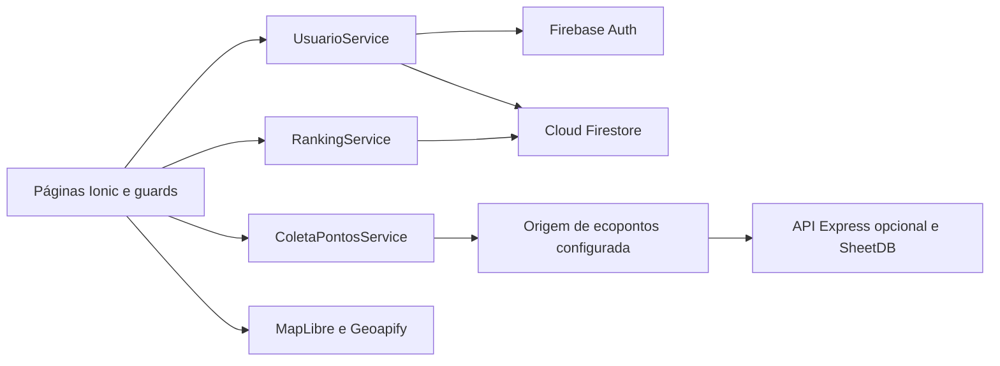

# EcoPonto

Aplicativo mobile feito com Ionic, Angular e Capacitor para incentivar o descarte consciente de residuos. O usuario consegue localizar ecopontos, registrar descartes com foto e localizacao, acompanhar pontuacao e participar de um fluxo de validacao administrativa.

## Objetivo

O EcoPonto conecta tecnologia e educacao ambiental para facilitar o descarte correto de materiais reciclaveis. A ideia central e transformar uma acao cotidiana em uma experiencia guiada, rastreavel e gamificada.

## Recursos principais

- Cadastro, login, recuperacao e alteracao de senha.
- Mapa de ecopontos com MapLibre GL e geolocalizacao.
- Busca de pontos de coleta via SheetDB e API auxiliar.
- Geocodificacao com Geoapify quando o ponto nao possui coordenadas.
- Registro de descarte com camera e localizacao.
- Ranking de usuarios por pontuacao.
- Area administrativa para validar descartes pendentes.
- Gerenciamento de administradores.
- Projeto Android via Capacitor, com script para gerar APK debug.

## Stack

- Ionic 8
- Angular 20
- TypeScript
- SCSS
- Capacitor
- Firebase Authentication
- Cloud Firestore
- MapLibre GL
- Geoapify
- Node.js e Express na API auxiliar

## Estrutura

```text
.
├── android/              # Projeto Android gerado pelo Capacitor
├── eco-api/              # API auxiliar em Node.js/Express
├── src/app/              # Paginas, rotas, guards e services do app
├── src/environments/     # Configuracoes de APIs e Firebase
├── firestore.rules       # Regras de seguranca do Firestore
├── capacitor.config.ts   # Configuracao do Capacitor
└── package.json          # Scripts e dependencias
```

## Como rodar

```bash
npm install
npm start
```

O app web abre normalmente em:

```text
http://localhost:4200
```

## Build e Android

```bash
npm run build
npx cap sync android
```

Para gerar um APK debug:

```bash
npm run apk
```

O script compila o Angular, sincroniza o Capacitor e gera o APK no projeto Android. Em Windows, tambem tenta copiar o arquivo para a Area de Trabalho.

## API auxiliar

A pasta `eco-api/` possui uma API Express para servir pontos de coleta e fallback local.

```bash
cd eco-api
npm install
node server.js
```

Rotas principais:

```text
GET /api/status
GET /api/pontos-coleta
GET /ecopontos
```

## Configuracao

Revise os arquivos abaixo antes de rodar em outro ambiente:

```text
src/environments/environment.ts
src/environments/environment.prod.ts
firestore.rules
```

Configuracoes importantes:

- `firebaseConfig`: projeto Firebase usado pelo app.
- `geoapifyApiKey`: chave para mapa e geocodificacao.
- `apiPontosColetaUrl`: origem dos dados dos ecopontos.

## Status

Implementação acadêmica com frontend mobile, Firebase, mapa, geolocalizacao, ranking, validacao administrativa e geracao de APK.

## Autores

- Gabriel Suliano
- Samuel Valentim
- Beatriz Freitas

## Arquitetura efetiva e persistência



O runtime usa Firebase Auth e coleções Firestore `usuarios`, `descartes`, `ranking`. `backend_schema.sql` é modelagem alternativa/histórica, **não o banco consumido pelos services atuais**. `src/main.ts` registra Storage, mas `RankingService` grava a foto em `fotoDataUrl` no documento; não presumir upload para Storage nesse fluxo.

O descarte fica pendente; a validação administrativa muda seu status e depois acrescenta dez pontos. São duas escritas sem transação conjunta: concorrência/falha parcial precisam de testes. `firestore.rules` complementa os guards; guards do navegador não são barreira de segurança do banco.

## Configuração e instalação detalhada

Use Node compatível com Angular 20/Capacitor 8, npm e, para Android, JDK/SDK compatíveis com o Gradle versionado. Prefira `npm ci`; `npm start` executa `ng serve`, normalmente na porta 4200. O script `apk` é específico de Windows e tenta copiar o APK para `Desktop`; confira o caminho antes de utilizá-lo.

O app lê `src/environments/environment.ts` e `environment.prod.ts`, selecionados pelo build Angular. Configure `firebaseConfig`, `geoapifyApiKey`, `apiPontosColetaUrl` para seus serviços de desenvolvimento. Não há loader `.env` para Angular. Chaves de cliente de mapas/Firebase exigem restrições/regras no provedor; não substituem autenticação.

A API auxiliar lê `PORTA_API` (padrão 3002), aceita `npm ci` e `npm start` em `eco-api/`, consulta SheetDB e usa fallback local. O app só a utiliza se `apiPontosColetaUrl` apontar para ela. A URL da planilha está definida em `eco-api/server.js`.

## Testes, estado e evolução

Há specs Jasmine/Karma de componentes e testes Android de exemplo. `npm test` chama `ng test`; o script `test` de `eco-api` apenas termina com erro por não haver teste configurado. Esses arquivos não comprovam cobertura de coleta/autorização. Não houve gravação, criação de conta ou implantação de regras nesta revisão.

Projeto acadêmico colaborativo, com integração dependente de configuração/permissões Firebase. Prioridades: testes em emuladores, atomicidade da validação/pontuação, tamanho das fotos e isolamento de configuração. Consulte [LICENSE](LICENSE); a autoria conjunta acima foi preservada.
